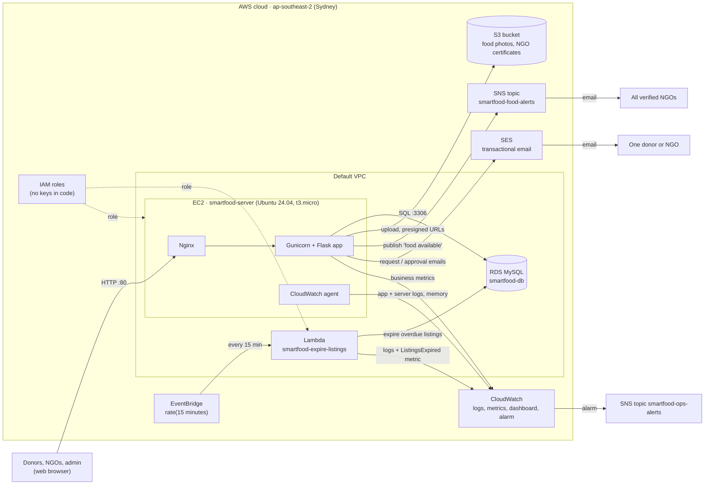

# Smart Food Rescue


-232F3E)


A cloud-based platform that connects food donors (college messes, restaurants, hotels, cafeterias)
with NGOs that collect and redistribute surplus food before it spoils.
Course project for **UCS531 – Cloud Computing**.

The whole application runs on **Amazon Web Services**: the website on EC2, the data on RDS, photos
on S3, email alerts through SNS and SES, a serverless Lambda job on a schedule, and monitoring in
CloudWatch. Section [How to see AWS in this repository](#how-to-see-aws-in-this-repository) points
to the exact code and configuration for each service.

---

## Cloud architecture



## AWS services used

| Service | What it does in this project | Name in our AWS account |
|---------|------------------------------|-------------------------|
| **Amazon EC2** | Hosts the website: Nginx in front of Gunicorn running the Flask app | `smartfood-server` (t3.micro, Ubuntu 24.04) |
| **Amazon RDS (MySQL 8.4)** | Stores users, food listings and pickup requests; private, with daily automated backups | `smartfood-db` (db.t4g.micro) |
| **Amazon S3** | Stores food photos and NGO registration certificates; bucket is private, pages use 1-hour presigned URLs | `smartfood-rescue-2026` |
| **AWS IAM** | EC2 and Lambda get temporary credentials from roles; least-privilege policy, no access keys anywhere | `SmartFoodEC2Role`, `SmartFoodAppAccess` |
| **AWS Lambda** | Serverless job that expires listings past their pickup time and declines their pending requests | `smartfood-expire-listings` (Python 3.12) |
| **Amazon EventBridge** | Runs the Lambda every 15 minutes | `smartfood-every-15-min` |
| **Amazon SNS** | Publish/subscribe: one "food available" message reaches every verified NGO | `smartfood-food-alerts`, `smartfood-ops-alerts` |
| **Amazon SES** | Transactional email to one person: new request (donor), approved / not approved (NGO), NGO verified | verified sender identity |
| **Amazon CloudWatch** | Log groups, custom business metrics, a live dashboard, and an alarm on Lambda errors | `/smartfood/app`, dashboard `SmartFoodRescue`, alarm `smartfood-lambda-errors` |

## How to see AWS in this repository

Every AWS service above is used from code or configuration in this repo:

| Service | Where to look |
|---------|---------------|
| **S3** | [`app/storage.py`](app/storage.py): `upload_file()` calls `upload_fileobj`, `file_url()` creates presigned URLs, `delete_file()` removes objects |
| **RDS** | [`app/db.py`](app/db.py): `get_db()` connects with PyMySQL when `DATABASE_URL` starts with `mysql://`; [`schema.sql`](schema.sql) is the RDS schema |
| **SNS** | [`app/notifications.py`](app/notifications.py): `subscribe_to_food_alerts()` and `new_food_alert()` call `sns.subscribe` / `sns.publish` |
| **SES** | [`app/notifications.py`](app/notifications.py): `send_email()` calls `ses.send_email`; used by `request_received()`, `request_decided()`, `ngo_verified()` |
| **CloudWatch metrics** | [`app/metrics.py`](app/metrics.py): `record()` calls `put_metric_data` (namespace `SmartFoodRescue`); called from [`app/donor.py`](app/donor.py) and [`app/ngo.py`](app/ngo.py) |
| **CloudWatch logs** | [`deploy/cloudwatch-agent-config.json`](deploy/cloudwatch-agent-config.json) ships `/var/log/smartfood/*.log`; app events are written in [`app/__init__.py`](app/__init__.py) |
| **CloudWatch dashboard** | [`deploy/cloudwatch-dashboard.json`](deploy/cloudwatch-dashboard.json) |
| **Lambda** | [`lambda/expire_listings/lambda_function.py`](lambda/expire_listings/lambda_function.py) (handler, Embedded Metric Format log line) and [`app/expiry.py`](app/expiry.py) (shared SQL); [`lambda/build.py`](lambda/build.py) builds the upload zip |
| **IAM** | [`deploy/iam-policy.json`](deploy/iam-policy.json): the least-privilege policy attached to the EC2 role |
| **EC2** | [`deploy/smartfood.service`](deploy/smartfood.service) (systemd + Gunicorn) and [`deploy/nginx.conf`](deploy/nginx.conf) |
| **boto3 setup** | [`app/aws.py`](app/aws.py): shared clients; credentials come from the IAM role, never from code |

Screenshots of the running AWS resources go in [`docs/screenshots/`](docs/screenshots/) (see the list there).

## Features

| Role  | Can do |
|-------|--------|
| Donor | Register, list food with a photo, see NGO requests, approve/reject, confirm handover |
| NGO   | Register with certificate, browse/search food, request pickup, track status, mark picked up |
| Admin | Verify NGOs, view certificates, deactivate users, remove listings, view platform stats |

Donation lifecycle: **Available → Requested → Approved → Picked up → Completed**.
Listings still available or requested after their pickup time become **Expired** (set by the Lambda job).
Approving one NGO's request automatically declines the others for that listing.

Notifications along the way:

| Event | Service | Who gets it |
|-------|---------|-------------|
| Admin verifies an NGO | SES + SNS subscription | That NGO |
| Donor posts food | SNS | Every subscribed NGO |
| NGO requests food | SES | The donor |
| Donor approves or rejects | SES | The NGO(s) |

## Design

Every dish is shown on a **round plate**, and a ring around the plate shrinks as its pickup time gets
closer (it turns red in the last hour), so NGOs can see at a glance what to collect first. The landing
page arranges the food currently waiting like a thali. Donors and NGOs follow each donation on a
five-step track (Listed, Requested, Approved, Picked up, Done). The stylesheet and script are plain CSS
and JavaScript in `app/static/`; only the Baloo 2 and Figtree fonts come from Google Fonts, with
system-font fallbacks.

## Project structure

```
smart-food-rescue/
├── run.py                  # entry point (gunicorn run:app)
├── schema.sql              # MySQL schema for AWS RDS
├── schema_sqlite.sql       # same schema for local development
├── requirements.txt        # Flask, PyMySQL, boto3, gunicorn
├── .env.example            # copy to .env (never commit .env)
├── app/
│   ├── __init__.py         # app factory, config, logging
│   ├── aws.py              # shared boto3 clients (credentials from the IAM role)
│   ├── db.py               # plain SQL: SQLite locally, MySQL on RDS; CLI commands
│   ├── storage.py          # S3 upload / presigned URLs / delete (local folder fallback)
│   ├── notifications.py    # SNS food alerts + SES emails (logged instead of sent locally)
│   ├── metrics.py          # CloudWatch custom metrics
│   ├── expiry.py           # listing-expiry SQL, shared by the Lambda and a local command
│   ├── security.py         # login sessions, role checks, CSRF protection
│   ├── utils.py            # time helpers, status labels
│   ├── auth.py             # register / login / logout
│   ├── donor.py            # donor dashboard, new listing, approve/reject, complete
│   ├── ngo.py              # browse + filters, request, my requests, picked up
│   ├── admin.py            # verify NGOs, manage users, remove listings, stats
│   ├── demo.py             # seed-demo command for presentation data
│   ├── templates/          # Jinja HTML pages (_ui.html: shared plate, food card, track, icons)
│   └── static/             # css/style.css and js/app.js
├── lambda/
│   ├── expire_listings/lambda_function.py   # AWS Lambda handler
│   └── build.py            # builds lambda/expire_listings.zip for upload
├── deploy/
│   ├── iam-policy.json              # least-privilege policy for the EC2 role (S3, SNS, SES)
│   ├── cloudwatch-agent-config.json # ships app logs + memory metric to CloudWatch
│   ├── cloudwatch-dashboard.json    # CloudWatch dashboard definition
│   ├── smartfood.service            # systemd unit for Gunicorn (logs to /var/log/smartfood)
│   └── nginx.conf                   # reverse proxy on port 80
├── demo_data/              # demo photos + sample certificates (used by seed-demo)
└── docs/screenshots/       # screenshots of the running AWS deployment
```

## 1. Run locally (no AWS needed)

```bash
python3 -m venv venv
source venv/bin/activate          # Windows: venv\Scripts\activate
pip install flask python-dotenv   # all the local version needs
cp .env.example .env              # Windows: copy .env.example .env
flask --app run init-db
flask --app run seed-demo --reset
flask --app run run --debug --port 5001
```
Open http://127.0.0.1:5001 (on macOS port 5000 is taken by AirPlay). Locally the app uses `local.db`
(SQLite) and saves photos to `uploads/`. Emails, SNS alerts and metrics are **printed in the terminal**
instead of sent, so you can see what would go to AWS.

Run the expiry job locally (the Lambda does this on AWS):
```bash
flask --app run expire-listings
```

### Demo data
```bash
flask --app run seed-demo --reset  # wipe everything and start fresh before each demo
```
Creates 4 donors, 3 NGOs (one unverified) and an admin, plus 13 listings with photos covering every
status. All demo accounts use the password `Demo@1234` (e.g. `mess@demo.in`, `rotighar@demo.in`,
`admin@demo.in`). One listing ("Jeera rice and dal") is already overdue, so the expiry job has
something to expire. Run on EC2, the photos upload to S3.

The food photos in `demo_data/photos/` are drawn illustrations; replace a file with a real photo under
the same name and re-run with `--reset`. The NGO certificates are watermarked "SAMPLE · DEMO DATA".

## 2. Deploy the core app on AWS

> New AWS accounts on the **Free plan** are locked to one region. Ours is **Sydney (`ap-southeast-2`)**,
> so every resource is created there. Other regions need the paid plan.

### a) S3 bucket
S3 → **Create bucket** → General purpose → a unique name (ours: `smartfood-rescue-2026`) →
keep **Block all public access** on → Create.

### b) RDS MySQL
Aurora and RDS → **Create database** → **Full configuration** → MySQL → **Free tier** template.
Identifier `smartfood-db`, username `admin`, self-managed password (letters and numbers only),
`db.t4g.micro`, 20 GiB gp2 with storage autoscaling off, **Public access: No**, Initial database name
`smart_food_rescue`, deletion protection off, RDS Proxy and Extended Support off.

### c) EC2
EC2 → **Launch instance**: name `smartfood-server`, **Ubuntu Server 24.04 LTS (x86)**, `t3.micro`,
a new key pair `smartfood-key` (.pem), 8 GiB gp3. Security group: SSH (22) and HTTP (80).

> If SSH times out, the SSH rule may hold your browser's IPv6 or iCloud Private Relay address.
> Replace it with an **Anywhere-IPv4** (`0.0.0.0/0`) rule; logging in still needs the key file.

### d) IAM role
1. IAM → Policies → **Create policy** → JSON → paste [`deploy/iam-policy.json`](deploy/iam-policy.json),
   replacing `YOUR-BUCKET-NAME` and `YOUR-ACCOUNT-ID` → name `SmartFoodAppAccess`.
2. IAM → Roles → **Create role** → AWS service → EC2 → attach `SmartFoodAppAccess` **and**
   `CloudWatchAgentServerPolicy` → name `SmartFoodEC2Role`.
3. EC2 → select the instance → Actions → Security → **Modify IAM role** → `SmartFoodEC2Role`.

### e) Connect EC2 to RDS
RDS → select `smartfood-db` → Actions → **Set up EC2 connection** → `smartfood-server`. AWS adds
security-group rules so only the server can reach port 3306.

### f) Install the app on EC2
```bash
ssh -o ServerAliveInterval=60 -i ~/.ssh/smartfood-key.pem ubuntu@<EC2-public-IP>
sudo apt update && sudo apt install -y python3-venv nginx git mysql-client
git clone https://github.com/khushiag200305/smart-food-rescue.git && cd smart-food-rescue
python3 -m venv venv && source venv/bin/activate && pip install -r requirements.txt
cat > .env <<EOF
SECRET_KEY=$(openssl rand -hex 32)
DATABASE_URL=mysql://admin:<DB-PASSWORD>@<RDS-ENDPOINT>:3306/smart_food_rescue
S3_BUCKET=<BUCKET-NAME>
AWS_REGION=ap-southeast-2
UTC_OFFSET_MINUTES=330
SNS_TOPIC_ARN=
SES_SENDER=
CLOUDWATCH_METRICS=0
EOF
flask --app run init-db
flask --app run seed-demo --reset
sudo cp deploy/smartfood.service /etc/systemd/system/
sudo systemctl daemon-reload && sudo systemctl enable --now smartfood
sudo cp deploy/nginx.conf /etc/nginx/sites-available/smartfood
sudo ln -s /etc/nginx/sites-available/smartfood /etc/nginx/sites-enabled/
sudo rm /etc/nginx/sites-enabled/default && sudo nginx -t && sudo systemctl reload nginx
```
Open `http://<EC2-public-IP>`. Logs: `tail -f /var/log/smartfood/app.log`.

**Updating after a code change:** `cd ~/smart-food-rescue && git pull && sudo systemctl restart smartfood`.

## 3. Add SNS, SES, Lambda and CloudWatch

### a) SNS
SNS → Topics → **Create topic** → Standard → `smartfood-food-alerts`. The app subscribes each NGO
automatically when the admin verifies it; the NGO confirms from the AWS email.

### b) SES
SES → Identities → **Create identity** → Email address, for the sender and every address you will
demo with (the account starts in the **SES sandbox**, which only delivers to verified addresses).
Tip: Gmail delivers `you+donor@gmail.com` and `you+ngo@gmail.com` to your own inbox, and SES treats
them as separate addresses.

### c) Turn notifications and metrics on
On EC2, set these in `.env`, then `sudo systemctl restart smartfood`:
```
SNS_TOPIC_ARN=arn:aws:sns:ap-southeast-2:<ACCOUNT-ID>:smartfood-food-alerts
SES_SENDER=<verified-sender@gmail.com>
CLOUDWATCH_METRICS=1
```

### d) Lambda: expire overdue listings
1. On EC2: `python lambda/build.py` → creates `lambda/expire_listings.zip` (handler, `expiry.py`, PyMySQL).
   Copy it to your computer: `scp -i ~/.ssh/smartfood-key.pem ubuntu@<EC2-IP>:~/smart-food-rescue/lambda/expire_listings.zip .`
2. Lambda → **Create Event Function** → name `smartfood-expire-listings`, runtime **Python 3.12**,
   **ARM64 architecture off** (x86_64; the zip is built for x86_64).
3. Code → **Update** → Upload .zip file → `expire_listings.zip`.
4. Configuration → General → Timeout **30 s**. Environment variables: `DB_HOST` (RDS endpoint),
   `DB_USER`, `DB_PASSWORD`, `DB_NAME=smart_food_rescue`, `UTC_OFFSET_MINUTES=330`.
5. RDS → `smartfood-db` → Actions → **Set up Lambda connection** → the function, **RDS Proxy off**.
   (If the function isn't listed, first put it in the database's VPC: Lambda → Configuration → VPC.)
6. Test with event `{}` → `{"listings_expired": 1, "requests_declined": 1}` on fresh demo data.
7. **Add trigger** → EventBridge → new rule `smartfood-every-15-min`, `rate(15 minutes)`.

### e) CloudWatch agent on EC2
```bash
wget https://amazoncloudwatch-agent.s3.amazonaws.com/ubuntu/amd64/latest/amazon-cloudwatch-agent.deb
sudo dpkg -i -E ./amazon-cloudwatch-agent.deb
sudo /opt/aws/amazon-cloudwatch-agent/bin/amazon-cloudwatch-agent-ctl -a fetch-config -m ec2 -s \
     -c file:/home/ubuntu/smart-food-rescue/deploy/cloudwatch-agent-config.json
```
Log groups `/smartfood/app`, `/smartfood/access` and `/smartfood/error` appear under CloudWatch → Logs.

### f) Dashboard
```bash
sed 's/DB_INSTANCE_ID/smartfood-db/g; s/INSTANCE_ID/<EC2-INSTANCE-ID>/g' \
    deploy/cloudwatch-dashboard.json > ~/dashboard.json && cat ~/dashboard.json
```
CloudWatch → Dashboards → Create `SmartFoodRescue` → Actions → View/edit source → paste → Update →
**Save** (autosave is off). Business metrics use a 5-minute period, so demo activity shows within minutes.

### g) Alarm
Create SNS topic `smartfood-ops-alerts` with an email subscription, then CloudWatch → Alarms →
Create alarm → Lambda → By Function Name → `smartfood-expire-listings` **Errors**, Sum, 15 minutes,
≥ 1 → notify `smartfood-ops-alerts` → name `smartfood-lambda-errors`.

### Useful Logs Insights queries (log group `/smartfood/app`)
```
fields @timestamp, @message | filter @message like /event=/ | sort @timestamp desc | limit 50
fields @timestamp, @message | filter @message like /email_|sns_/ | sort @timestamp desc
fields @timestamp, @message | filter @message like /ERROR/ | sort @timestamp desc
```

## Running costs and shutting down

The project runs on the AWS **Free plan** credits.
- **Stopping for the day:** disable the Lambda's EventBridge trigger, then stop RDS
  (Actions → Stop temporarily) and EC2 (Instance state → Stop). Start RDS first, then EC2, then
  re-enable the trigger. EC2 gets a new public IP after each start.
- RDS restarts by itself after 7 days stopped.
- **After the project:** delete the EC2 instance, the RDS database, the S3 bucket, the Lambda function,
  the SNS topics, and the CloudWatch dashboard and alarm.

## Security

- Passwords hashed with Werkzeug; CSRF tokens on every form; role checks on every route.
- No AWS keys in code or `.env`: EC2 and Lambda get temporary credentials from IAM roles.
- The EC2 role can only touch one S3 bucket and one SNS topic (least privilege).
- S3 bucket is private; images are served through presigned URLs valid for 1 hour.
  NGO certificates are only shown to logged-in admins.
- RDS is not publicly accessible; only the EC2 and Lambda security groups can reach port 3306.
- Uploaded files get random names (UUID), are type-checked and limited to 5 MB.
- Failed logins are logged (`event=login_failed`) to CloudWatch Logs.

## Demo script

0. `flask --app run seed-demo --reset` so the dashboards start full. Register one donor and one NGO
   with SES-verified emails for the live part.
1. Donor posts food with a photo → show the object in the S3 console, and the SNS "Food available"
   email arriving for subscribed NGOs.
2. Admin verifies the new NGO → the NGO gets the SES "verified" email and the SNS confirmation.
3. NGO requests pickup → donor gets an SES email → donor approves → NGO gets the approval email.
4. NGO marks picked up → donor confirms collection.
5. Lambda console → Test (or wait for the schedule) → "Jeera rice and dal" becomes Expired; show the
   Lambda's log in CloudWatch.
6. CloudWatch dashboard: meals rescued, donations, server CPU and memory, Lambda runs, recent app events.
